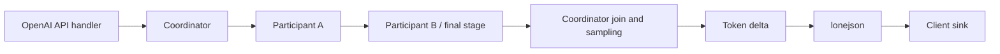

# Llama inference receiver and API adapter contract

Specification extension, 2026-10-14. This document supersedes the earlier text-only
receiver restrictions in [architecture.md](architecture.md). Implement the
complete backend contract before its comprehensive acceptance campaign. HTTP
server integration is subsequent work. Implemented JSON/SSE adapters and their
remaining integrations are described in [openai.md](openai.md).

## Investigation and design decision

The existing strict C89 facade exposes native loading, evaluation, sampling,
grammar, state and memory operations, including complete pinned public callback
coverage. The initial text receiver, model acquisition/cards, scoped pslog
logging and Lua facade are implemented. Adapter progress is listed below;
the complete contract still governs acceptance. Native coverage alone does not
provide the complete conversation API.

The private adapter foundation now decodes Chat Completions and Responses
request JSON through lonejson into owned receiver input. It maps text histories,
function calls/results, function definitions/choices, structured-output schemas
and supported sampling controls, and preserves storage, continuation and
compaction controls separately. The JSON body is capped at 8 MiB, with 64 levels
and 32768 object members; expanded owned input uses the continuation's 64 MiB and
4096-item/part bounds, with a separate 4 MiB text/arguments limit. Schema fragments are explicitly materialized within
64 KiB through lonejson's writer. Counts require integer literals; invalid,
conflicting, duplicate and unavailable semantics fail instead of being ignored.
This is request materialization, not generated-output buffering. Public Chat
and Responses JSON/SSE and C repository operations are now connected through
[the adapter surface](openai.md). The in-process handler/model routes are
implemented; HTTP server integration remains subsequent work.
Stored Chat list/metadata update, paginated messages/Responses input items,
conversation objects/items, standalone and
automatic Responses compaction and authenticated reasoning replay are connected. Lua
exposes the same retention profile,
repository receiver and direct retrieval/deletion primitives through the C ABI.

API function schemas use the existing private schema helper for the documented
[strict-mode defaults](https://developers.openai.com/api/docs/guides/function-calling#strict-mode):
Chat defaults to best effort; Responses attempts closed objects with every
property required when strict is unspecified, falling back to best effort when
the schema cannot be normalized by the qualified grammar subset. Explicit
`strict=false` opts out, and explicit true rejects incompatible object schemas
or unsupported constraints. Normalized definitions expose their effective
strictness. Responses' `max_tool_calls` is preserved as its built-in-tool limit;
it is never reinterpreted as the neutral receiver's function-call limit.

The official [Responses migration guide](https://developers.openai.com/api/docs/guides/migrate-to-responses)
distinguishes messages/choices from typed response items and continuation state.
The documented API is Responses; this investigation found no separate published
"Responses API 2.0" contract. Prepare for evolution through explicit item types
and capabilities, without inventing a version or silently accepting unknown
semantics. The future handler must target an identified official schema.

The [Chat Completions reference](https://developers.openai.com/api/reference/resources/chat/subresources/completions/methods/create)
includes function tools, output formats, sampling controls and log probabilities.
The backend must represent these behaviors without each handler reimplementing
tokenization, decoding, template application or state management.

Three layers have distinct responsibilities:

| Layer | Responsibility |
| --- | --- |
| Complete native C89 facade | Faithful access to pinned llama/GGML/mtmd public APIs; native ownership and semantics |
| Inference receiver | Model/device lifecycle, typed conversation items, template/grammar selection, sampling, incremental output, cache/state and compaction |
| Protocol adapters | Parse/validate API requests, map fields into receiver requests, and serialize events/results into the API's documented JSON/SSE contract |

Model acquisition and model cards are shared receiver facilities. A handler is
not expected to construct native batches or inspect GGUF fields. The backend
does not depend on HTTP objects, API keys, sockets, Kore, or an OpenAI service.
Tools are returned to the embedding application for execution; libailo never
executes an arbitrary model-generated function or launches a hosted service.

## C89 surface and ownership

Retain `ailo_client_new` and the receiver shell with equivalent free functions.
Add `generate`, `compact`, `capabilities`, `cache_stats` and `cache_clear` methods
alongside chat/model/device conveniences. Use separate small request, item,
event and continuation-state types; the client owns implementation state, not
every protocol's mutable JSON representation.

The neutral generation operation has this shape:

```c
ailo_status ailo_client_generate(ailo_client *client,
                                const ailo_request *request,
                                ailo_event_sink sink, void *user_data,
                                ailo_run_info *out_info, ailo_error *error);
```

The initial `generate`, `capabilities`, model-card and device surface is now
implemented; [docs/client.md](client.md) records its exact supported subset.
The remaining names and behavior below describe the complete implementation
contract, not a claim that all methods already exist.
Requests use tagged C89 records/opaque owned handles and arrays with explicit
lengths. Provide default factories, constructors/builders, getters and cleanup
as appropriate; public callers never include C++ or upstream headers. Fallible
constructors clear outputs. Configuration strings/arrays are copied; synchronous
request data is borrowed for the call, and retained state is explicitly owned.
Callbacks borrow event payload only until return. A sink consumes every supplied
event or fails/cancels; backpressure is synchronous. `out_info` contains bounded
terminal status, identities, usage and diagnostics, not the complete output.
All exact-width counts use the established C89 integer representations.

Buffered protocol operations collect events into an explicitly bounded owned
result. Streaming operations forward events as generation progresses and do not
collect a second complete result. Equivalent C89 APIs expose standalone
compaction and replayable state without requiring a JSON handler.

Keep client context access serialized with busy/reentry rejection. Distinct
clients have independent samplers, parser state, contexts and continuations.
Model weights may be shared by an explicitly owned internal model resource;
mutable contexts and request state cannot be shared accidentally. Reference
counted backend initialization must survive independent client destruction.

## Conversation and event model

Represent ordered items, not just role/content strings. Required item kinds are
messages, function calls, function results, reasoning and compaction. Messages
carry system/developer/user/assistant/tool roles where applicable, optional
participant names, and typed content parts. Function calls preserve item ID,
call ID, function name and arguments; results refer to the original call ID.
Keep different identifiers separate and validate duplicate/orphan results and
pending call groups before inference. A continuing tool cycle is ordinary input,
not a fresh text prompt that discards tool provenance.

Content types distinguish text, refusal, and supported media references/bytes.
Carry image/audio/file identities and prepared media data through a distinct
multimodal adapter using the pinned mtmd APIs. Raw URL/file-ID resolution and
document extraction belong to explicit embedding-application services, with
byte/time limits; the inference engine does not fetch arbitrary user URLs.
Media, custom tools and other item types require actual model/template/adapter
capabilities. Preserve extensibility without treating an unknown item as text.
The [multimodal receiver design](multimodal.md) records candidate model/projector
pairs, execution, wire mappings, replay/storage, admission defaults and the
implemented image/audio-input scope with streamed text output.

Generation events include run/item/content start, text/refusal/reasoning deltas,
function identity and argument deltas, item completion, compaction, usage and
terminal completion/incomplete/error. Preserve sequence, candidate, item and
content indices plus stable IDs. Bound item names/IDs and parser lookahead;
never postpone an entire tool argument or answer until end-of-generation just
to produce a streaming-shaped result.

The [Responses streaming guide](https://developers.openai.com/api/docs/guides/streaming-responses)
uses typed lifecycle and delta events. The Responses adapter maps neutral events into
those documented event types; Chat Completions maps them into choices/deltas.
Its SSE terminator is a protocol detail, not an inference-engine event.

The [Responses streaming-event reference](https://developers.openai.com/api/reference/resources/responses/streaming-events)
requires full finalized text/arguments/items in done events and full output in
the completed response, in addition to incremental deltas. Repeating these bytes
requires retained output; replay cannot be supplied from bounded lookahead alone.
Production decision, 2026-10-15: the Responses adapter explicitly retains output
in quota-bounded memory to supply these terminal objects, while forwarding every
delta immediately. This retention cannot postpone deltas or introduce a hidden
disk spool; the neutral receiver retains its bounded incremental path. Enforce
the output quota during generation and report failure without false completion.

Transient output retention is distinct from stored-response retention. Follow
the official [conversation-state contract](https://developers.openai.com/api/docs/guides/conversation-state):
Responses defaults to store=true and response records remain retrievable for at
least 30 days; store=false creates no retrievable response record. Conversation
items explicitly attached to a conversation have no automatic 30-day expiry.
The library defaults to encrypted Pouch persistence in the XDG state directory,
with its automatically generated key in the XDG configuration directory;
[persistence](persistence.md) specifies paths, publication and cleanup. The
embedding handler supplies authorization and may override the repository;
do not substitute an evictable KV cache or silently weaken the retention period.
An unavailable repository must reject storage-dependent requests before inference.
Deletion, retrieval and previous_response_id use that repository. Temporary
terminal-event assembly for store=false is released when the operation ends.

The private retention planner resolves these requirements before repository
admission: it separates response storage, prior-response reads and conversation
reads/appends, requires a trusted application namespace and the corresponding
repository capabilities, and rejects Responses TTLs below 30 days or overflowing
expiry timestamps. Chat now connects repository reservation, atomic writes,
retrieval and deletion; Responses now connects these operations and accumulated
`previous_response_id` lineage, excluding prior top-level instructions. Explicit
conversation persistence now uses atomic revision-checked mutations and a
separate item archive, including store=false. Neither
request `user` nor `safety_identifier` grants access.

Current [OpenAI migration guidance](https://developers.openai.com/api/docs/guides/migrate-to-responses)
also documents default Chat storage for new accounts. Libailo deliberately
defaults Chat storage off: clients own the history sent on each turn. Explicit
`store=true` enables retained completions; trusted `chat_store_by_default` can
enable default storage. Stored Chat records have a local 30-day TTL from
creation, with a configurable finite application TTL. Zero selects 30 days;
there is no indefinite Chat TTL setting. Reads and metadata edits preserve the
original deadline. This is a local repository policy, not a claim of an
undocumented OpenAI expiry deadline.

Under the documented [data controls](https://developers.openai.com/api/docs/guides/your-data),
ZDR forces response `store=false` in both APIs, including an explicit true.
Conversations and their items are outside that eligible endpoint contract and
remain until deleted; attaching a conversation still requires repository
read/append admission even with `store=false`. A response's expiry must not
expire its conversation items. The planner also distinguishes transient
Responses terminal-object assembly from retained response records; Chat
streaming without storage requires no full output collector.

Expose actual capability flags and limits in `capabilities` and the model card:
text, media types, tool formats, schema subset, reasoning separation/controls,
logprobs, native sequence reuse and compaction. API fields requiring an
unavailable capability fail explicitly. A model advertising a template is not
proof that its tokenizer, parser and backend can perform all requested work.

## Generation functionality needed by adapters

Support ordered text/content input, multiple independently sampled candidates,
output-token limits, temperature/top-p, frequency/presence penalties, token-ID
logit bias, seed, stop sequences, token log probabilities and requested top
alternatives. Map limits and candidates according to the target API. Validate
ranges and contradictory settings before evaluation; enforce finite resource
limits for candidate count, top alternatives, schema/tools and output bytes.
Recreate sampler history for each logical request even when a prompt is reused.
Logprob reporting must document its relation to bias, penalties, filtering and
temperature and match the selected API semantics; raw logits are not logprobs.
Seed is reproducibility control under a fixed configuration, not a guarantee
of identical output across devices or numerical implementations.

The implemented receiver exposes raw sampled-byte ranges on text, reasoning
and argument deltas, plus exclusive classification watermarks when logprobs
are requested. These preserve provenance through UTF-8 carry, hidden template
framing and context rebuilds without collecting the reply. Adapters must use
these ranges to associate visible bytes with sampled-token probabilities and
release settled metadata; substring guessing cannot distinguish repeated text
or suppressed framing. Chat's wire projection is implemented in its adapter;
the neutral token event itself is not an OpenAI content-logprob object.

Support function-tool definitions and histories, tool choice none/auto/required/
named function, and one or multiple calls where the model/template supports it.
Parallel tool calls means multiple returned calls, not concurrent native model
evaluation or automatic execution. Preserve function argument bytes and use
lonejson for validation/serialization. Strict mode constrains and validates the
supported schema subset; invalid generated arguments cannot be emitted as a
completed valid call. End with the appropriate tool-call outcome rather than a
fake text finish. Follow the [function calling contract](https://developers.openai.com/api/docs/guides/function-calling).

Support text, JSON-object and constrained JSON-schema output, including strict
tool arguments. Publish the precise accepted schema keywords and limits from
the implemented grammar converter; reject unsupported constraints before
generation instead of silently dropping them. Incremental fragments may be
incomplete JSON; a successful final result must satisfy its promised format.
Truncation, cancellation or grammar failure cannot claim schema-complete output.

Source inspection found two concrete converter hazards: number nodes use the
unrestricted number grammar, and oneOf is parsed into the same union structure
as anyOf. Upstream converter success therefore does not prove numeric bounds or
exclusive alternatives are enforced. Validate a closed keyword set and schema
semantics before use, adapt constraints where required, and validate successful
results incrementally. Required baseline coverage includes object properties/
required/additionalProperties, arrays/items and size bounds, scalar/null types,
enum/const, nullable alternatives and same-document references. Add tests for
every advertised numerical, string/pattern and combination constraint; an
unsupported keyword or ignored converter warning is a pre-generation error.

Separate reasoning from user-visible answer text where the qualified model and
template provide an unambiguous format. Reasoning-token budgets count toward
the total generation limit. Do not relabel raw reasoning as a supported summary,
invent another provider's encrypted reasoning state, or implement reasoning
effort by silently changing temperature. Unsupported controls fail clearly.
Tool, reasoning and content parser state remains independent per candidate.

The Responses adapter now emits authenticated local encrypted reasoning items
for replay, as described in [the adapter contract](openai.md#encrypted-reasoning-replay).
This is local canonical state, not an OpenAI-issued token or a claim of compatible
proprietary latent state. Native receiver generation still retains no complete
reasoning item; the already-declared Responses typed-output owner supplies it.

Finish reasons, actual usage, UTF-8/stop handling, cancellation, device failure
and sink failure follow architecture.md. Context overflow never silently drops
messages. Compaction policy below is the explicit way to reduce context.

## Private llama helper integration

Pinned `llama_chat_apply_template` accepts only role/content messages and a
predefined template set; llama.h explicitly says it is not a Jinja parser.
Richer template/tool/schema support is in upstream common sources, including
chat.cpp, jinja, json-schema and json-schema-to-grammar. Reuse a deliberately
selected private helper subset rather than importing llama-server or its whole
common target (which includes HTTP, downloads, CLI and subprocess code).

These private sources are implementation dependencies, not additions to the
public facade inventory. Upstream's private common_json uses vendored nlohmann
JSON 3.12.0 (MIT). Allow that private upstream dependency for its existing
template/schema helpers; keep lonejson authoritative for all application-facing
JSON and escaping. Do not expose either dependency in installed headers or
write a replacement general JSON parser. Record selected upstream/vendor
source lists and notices and keep their native archive separate from libailo.a.
Do not enable optional llguidance/Rust, subprocesses, HTTP server or new external
dependency downloads as a side effect of helper integration.

The pinned server's task_result_state::update_chat_msg appends generated_text
and reparses it, and server-context.cpp also accumulates the reply. That path
violates this project's streaming contract even when it sends intermediate
chunks. Use bounded incremental template-envelope parsing and lonejson's writer
and value-stream facilities for JSON fragments. Prove the selected parser's
memory bound; unsupported streaming formats need an actual parser adaptation,
not hidden full-message buffering. Request/template/schema materialization and
bounded compaction summaries are explicitly different from streaming output.

## Prompt reuse and persistent snapshots

Prompt/KV reuse is a required performance capability. It reuses evaluated state
for an exact matching token prefix, not a generated response cache and not a
conversation archive. Independent logical requests remain independent.
[vLLM documents prefix reuse](https://docs.vllm.ai/en/latest/features/automatic_prefix_caching/);
[LMCache documents optional persistence](https://docs.lmcache.ai/mp/l2_storage.html).
These establish real backend practices, not a claim that all backends share a
portable cache format or OpenAI guarantees restart-persistent KV storage.

Provide bounded in-memory reuse and opt-in disk snapshots. Default memory cache
is private to one client, capped at 64 MiB and eight entries, with a five-minute
idle TTL; explicit configuration can disable it or change those bounds. A
snapshot larger than the budget is not cached. Persistent caching is off until
the application supplies an absolute root or accepts the configured model-cache
root's inference subdirectory, an explicit nonzero disk budget/TTL, namespace
and encryption key. Model files, inference snapshots and conversation records
have separate eviction/ownership rules. Cache clearing never deletes weights.

Cache identity includes verified model/shard content digests, tokenizer and
effective template identity, adapters/control vectors, exact rendered tokens,
native revision/patch/build identity, context/RoPE/attention/KV settings and
qualified backend/device layout. Hash model bytes when validated digests are
unavailable; filenames/size/mtime alone cannot establish cache identity.
Include media/preprocessing and grammar/tool inputs when they affect rendering
or evaluation. A supplied prompt cache key selects an application namespace;
it never overrides content/configuration matching or acts as authorization.
Share across clients only with an explicit cache owner and trusted namespace
supplied by the embedding application. No ambient process-global tenant cache.

Find the longest safe matching prefix and evaluate its suffix. KV sequence
copy/removal and state restoration are architecture dependent; full-attention,
sliding-window and recurrent models require distinct validated reuse behavior.
If a prefix cannot be retained/restored correctly, recompute it and report a
miss, rather than shifting positions and claiming equivalent state. Recreate
sampling/grammar state from the request. Restore paths may need to replay the
final prefix token to obtain valid logits; count only actually skipped prompt
evaluation as cached tokens.

Use llama sequence-state APIs with host-portable state for durable snapshots;
ON_DEVICE state is transient and invalidated by subsequent snapshots. Native
state formats alone do not establish model compatibility: inspect a project
envelope with authenticated identity, token count, lengths and checksum before
native restore. Reject truncated, stale or incompatible data without mutating
the active context. Restore into disposable state, then adopt on success.
On corrupt/expired automatic cache entries, evict and recompute with diagnostics;
an explicitly requested import fails clearly. Snapshots save prompt state, not
sampler RNG/grammar/parser state for resuming a suspended generation.

Persistent publication is atomic under a scoped lock, with private permissions,
no-follow path handling, strict length limits and quota/TTL eviction. Encrypt and
authenticate snapshots using SDK OpenSSL AES-256-GCM, unique random nonces and
purpose-specific key derivation; application key IDs support explicit rotation.
Do not write plaintext prompts/KV to a hidden staging file. A bounded materialized
native state buffer is allowed and accounted in the configured snapshot/RSS
budget; this export is not advertised as streaming. The public native buffer
APIs require a complete state buffer, while native file APIs write directly to
files without a public encryption sink. Never disguise either as incremental
encrypted export. Oversized automatic snapshots are skipped with diagnostics.

Expose hits/misses/evictions, cached/evaluated prompt tokens, bytes and timing.
Caching must not hide context-token usage or imitate provider billing. Mapping
`prompt_cache_key`, retention or breakpoint fields into local policy requires a
documented implementation of their requested semantics; unsupported retention
or minimum-lifetime guarantees fail instead of becoming advisory no-ops.
The [OpenAI caching guide](https://developers.openai.com/api/docs/guides/prompt-caching)
describes prefix matching and cached-token accounting; our local policy and
resource limits must be explicit rather than borrowing its cloud guarantees.

## Continuation and retained conversation state

The local owned continuation receiver is implemented in
[`ailo/continuation.h`](../include/ailo/continuation.h). Its transactional input,
explicit output ownership, fork and model/template binding semantics are in
[the client documentation](client.md#owned-continuation-state). Protocol records
use the implemented [adapter repository](openai.md#retained-records), separately
from the evictable inference cache. Standalone semantic compaction, authenticated replay and
explicit automatic preflight/in-flight compaction are implemented as described
in [the client documentation](client.md#automatic-preflight-and-in-flight-compaction).

Provide owned canonical continuation state containing ordered items, current
instructions/protected items and model/template identity, separately from KV
cache entries. Explicit clone/fork operations preserve immutable prior state.
Appends and inference updates are committed only on the documented successful
outcome; cancellation/failure cannot silently replace the caller's history.
A tool-call outcome may legitimately leave a pending call group for the next
turn. Busy state cannot be mutated from a callback.

Canonical items come from supplied input, explicitly buffered results, or an
explicit caller/adapter-owned transcript. Neutral streaming generation does not
silently collect complete assistant messages into this state. Its native token/
memory window is bounded inference state, not a durable transcript. An embedding
application wanting full-history replay must own that collection explicitly;
the Responses adapter retention decision above governs its required terminal
objects. These rules apply even when canonical state and KV state share an owner.

This supplies the foundation for replayed items, `previous_response_id` and
conversation objects. Those wire identities and stored response lookup belong
to the future handler/state repository, not to the KV cache. Cache eviction must
not delete canonical conversations. Storage is explicit; store=false cannot
create durable transcript records through a hidden output collector. Retained
records have their own bounded policy and deletion semantics. No database
dependency is implied; future persistence adapters require a separate contract.

The future Responses adapter must preserve ordered typed input/output, tool call
IDs, per-request instructions and failure/incomplete states. It must not turn
a response-ID lookup into append-only role/content strings or inherit top-level
instructions contrary to the official API. Hosted tools, file services,
background jobs and protocol transports need their own explicit adapters;
representing an item type does not claim those services exist locally.

## Server-side semantic compaction

Compaction reduces model-visible context while carrying forward useful state.
It is required alongside caching; truncating KV positions, discarding early
messages or compressing serialized bytes is not semantic compaction. Use the
loaded model in a separate bounded compaction context to generate a structured
summary of older eligible history, constrained/validated through the selected
schema path. Its quality depends on the actual local model; it is not OpenAI's
proprietary latent compaction algorithm.

Protect current system/developer instructions and tool definitions byte-for-byte,
explicit pinned application items, recent complete turns, unresolved tool calls
and their dependencies. Compact only complete older groups; preserve role/trust
provenance, user goals, commitments, identifiers and essential tool findings in
the summary. A generated summary stays lower-trust context data, never a new
system instruction. Summary generation is bounded materialization, not a
streaming user reply. Record before/after context tokens, summary work and which
items were retained, without logging private content.

Support explicit `compact` and configurable automatic thresholds. Automatic
compaction is disabled by default, enabled by an explicit policy with trigger,
target, recent-turn/pinned retention and summary/output reserves. Count the
rendered prompt with the actual tokenizer, including instructions/tool schemas,
and reserve space for generation and the compaction pass before hard overflow.
Reject impossible thresholds or policies before inference. Input already too
large for one summary pass is processed as bounded complete groups with a
finite pass/work budget, or fails explicitly; never feed an oversized prompt
to native assertions or silently discard an oversized protected item.

When generation crosses the configured threshold, compact at a safe token/item
checkpoint, emit a compaction event, rebuild native context and continue with
stable run/item IDs and parser/sampler state. Preserve already-emitted output;
do not replay it to the sink. In-flight tool arguments and retained unfinished
content must remain coherent. If these protected spans alone cannot fit, return
an explicit context/incomplete outcome. Keep model context/token history bounded
by its configured window; do not retain an extra unbounded copy of generated
text or spool it just to enable compaction.

Validate summary structure, token reduction and all pinned invariants, then
atomically adopt the new canonical window. Failure/cancellation leaves prior
state intact and returns a compaction error; no infinite retry loop or silent
truncation. Rebuild cache matching against the new rendered prefix; old KV is
not valid for summarized text. Compaction work and cache invalidation are
separately observable. Test semantic preservation with deterministic scenarios;
do not promise a lossy summary preserves every original fact.

## Compaction items and API-specific output

The official [compaction guide](https://developers.openai.com/api/docs/guides/compaction)
specifies opaque encrypted items for Responses, automatic context management
and standalone compaction. Standalone Responses compaction now returns that
canonical window, including retained items and an authenticated opaque envelope.
Automatic context-management emits compaction output items in the same stream
and supports pruning before the latest completed automatic item. A final
`compaction_trigger` input on Responses create performs an immediate compaction-only
Response through the same serializers and persistence contract. This is the
current Codex remote-compaction protocol. Its opaque item carries the complete
canonical checkpoint; already-small histories can be checkpointed without a
summary pass. HTTP and real Codex acceptance cover continuation after compaction.
Local tokens are
replayable by compatible libailo instances only; OpenAI-issued encrypted content
cannot be decrypted or accepted as local state, and vice versa.

Expose an owned opaque compaction item from the backend, with item ID and
encrypted_content. Its authenticated payload binds compacted state to model/
tokenizer/template identity, namespace, item order/cut boundary, retained-item
digests, instructions policy, issue/expiry and format identity. Use SDK OpenSSL
AES-256-GCM with random nonces and purpose-separated keys. Authenticate before
parsing; cap decoded/encrypted lengths and decompression is unnecessary.
Duplicate/superseded/misordered items and missing required retained items fail.
Authorized reuse/fork is allowed; replayability is not a single-use nonce rule.

Configuration supplies key ID and copied key bytes (or a documented key lookup
callback). Without a configured stable key, generate an ephemeral client key
and make the resulting client-lifetime portability explicit. Cross-client or
restart replay requires explicit compatible identity, namespace and keys; no
automatic plaintext key file. Support a bounded set of old decryption keys for
rotation, issue with the current key, and erase owned keys on destruction.
Wrong key, tampering, expired state or changed identity returns an actionable
error without leaking payload. Authenticate binding of retained context before
adopting state; a ciphertext valid in another tenant is not valid here.

Chat Completions content follows its requested text/JSON format; text can be
Markdown. Its documented endpoint set has no equivalent compaction operation.
Do not invent a compact endpoint, new field or Markdown compaction response and
label it OpenAI compatible. The embedding application may explicitly use the
neutral compaction/generation APIs with replayable state, but
automatic lossy mutation of a stateless Chat Completions request is not a hidden
default. Responses maps replayable compaction state into its documented items.
Any libailo-specific diagnostics or readable summary access is clearly separate
from those wire contracts. [Chat endpoint reference](https://developers.openai.com/api/reference/resources/chat/subresources/completions).

## Future distributed coordinator/participant backend

Distributed inference is an intended future capability, explicitly outside the
first few versions. It adds no current release gate or requirement to implement
network participants now. Local multi-GPU layer splitting remains required under
the existing static Vulkan contract.

One libailo instance acts as coordinator behind the application's OpenAI API
handlers. Other instances act as inference participants. The coordinator owns
request admission, model/graph placement, route configuration, sampling and
client-visible events. This is our distributed runtime over library backends,
not deployment of llama-server or its HTTP frontend.

The coordinator establishes the computation plan. Each downstream participant
receives its assigned work and forwarding configuration from its authorized
upstream peer. Configuration identifies the model/graph, assigned layers or
stage, permitted next participant(s), and the coordinator destination/join for
the final stage. The coordinator remains the authority for the plan even when
its configuration is delivered through participants.

Activation routing follows the assigned computation graph:



Intermediate activations travel directly between configured participants;
they need not bounce through the coordinator at every stage. The final stage
returns its result to the coordinator, or contributes to a coordinator-owned
join when the plan has multiple branches. Join behavior must follow the model
graph, not an assumed generic concatenation or reduction. Assigned weights and
KV state stay with their owning stages during execution.

TCP/IP is the baseline network transport, with mTLS for authenticated, encrypted
peer connections or an explicitly selected equivalent. Authenticate control and
activation traffic on every hop, including participant-to-participant paths.
Authorize peer identities for the assigned stages and destinations; a forwarded
configuration cannot grant arbitrary routing authority. Route changes must be
bound to a plan identity so in-flight work cannot mix old and new assignments.

libailo automatically provisions the cluster certificates. The main/coordinator
instance owns the cluster CA; every participant trusts that instance's CA
certificate and validates other cluster peers against it. Issue a separate
coordinator leaf certificate and an individual participant leaf certificate,
with authenticated cluster/node identity and role. CA trust does not by itself
authorize every node to administer the cluster or change another node's routes.

Participants generate and retain their own private keys, submit certificate
signing requests through authorized enrollment, and install the issued
certificate/chain automatically. Automate renewal before expiry and certificate
replacement without requiring manually issued participant certificates. Keep
the CA signing key exclusively with the main instance; participants receive its
public trust certificate, never the CA private key. Use the existing SDK OpenSSL
foundation rather than adding an external certificate service prerequisite.

Bootstrap must establish authentic CA trust and enrollment authority before
accepting peer instructions: supply the CA certificate or pinned fingerprint
and a scoped enrollment credential through a trusted provisioning channel.
Fetching and trusting an arbitrary endpoint's advertised CA is insufficient.
Certificate, key and enrollment state belongs in explicitly configured durable
private storage, separate from evictable model/inference caches; cache clearing
must not destroy the cluster identity. Never log enrollment secrets or keys.
Define credential lifetime/reuse, revocation, CA rotation, restart/recovery and
certificate failure behavior with the distributed protocol before implementation.

Bind activation frames and joins to request, sequence, decode step/microbatch,
stage, plan and model identity, with explicit tensor type/shape/length and finite
message/queue limits. Propagate cancellation, backpressure and failures through
the graph. A failed participant cannot produce a false successful token or
leave downstream work running indefinitely. Detailed protocol, retry/recovery,
join, certificate-lifecycle and compatibility contracts must be specified and tested
when this capability becomes active work.

The pinned GGML RPC backend is a candidate foundation for remote device/graph
execution. The direct forwarding, authenticated routing configuration and
coordinator joins above are additional requirements to qualify or implement;
existing RPC availability does not establish that topology or production safety.
The distributed profile must retain the permissive userspace, static deployment
and strict C89 public-boundary requirements of the local runtime.

Client output still uses the same incremental receiver path. Emit each safe
generated token piece through lonejson and the sink immediately; never wait
for a text buffer to fill or an answer to complete. Necessary bounded transport
and UTF-8/stop-prefix carry do not authorize output batching. Network pipeline
execution and client-visible token streaming are separate responsibilities.

## Required verification

Implementation is complete only with observable proof across these boundaries:

- Strict C89/C++ header isolation, receiver lifecycle, event ownership, callback
  failure/reentry, independent clients and full facade coverage.
- Native trained buffered/streamed chat, multiple candidates, penalties/bias,
  logprobs, reasoning separation, tool/result cycles and strict schema output.
  Use qualified trained fixtures in addition to deterministic native fixtures;
  the small SmolLM2 smoke cannot qualify every reasoning/tool/media capability.
- Adapter contract fixtures for Chat Completions and representative Responses
  item/event/state mappings. Prove both use the same evaluation path. No HTTP
  server or live OpenAI call is required to test backend protocol mappings.
- Prefix-hit and cold-run continuation equivalence within documented numerical
  tolerances, longest-prefix edits, final-token replay, recurrent/SWA boundaries,
  model/template/schema/media changes and namespace isolation. Measure skipped
  evaluation and latency; merely restoring bytes is not proof of a useful hit.
- Cache quota/TTL/clear behavior, independent clients, restart persistence,
  corruption/truncation/wrong-key/wrong-model rejection, atomic interruption,
  symlink defenses and no plaintext staging. Snapshot buffer/RSS bounds must be
  measured separately from model/context memory.
- Compaction threshold/target/reserves, explicit and automatic passes, completed
  and pending tool groups, protected instructions, semantic scenario retention,
  rollback on failure/cancellation, token reduction and safe mid-generation
  continuation. Verify changed prefixes invalidate stale KV reuse.
- Opaque item round-trip, tamper/expiry/identity/tenant/order checks, key rotation,
  retained-window replay and deterministic rejection of foreign-provider items.
  Successful opaque replay cannot be implemented as an expired KV-cache lookup.
- Long generated output and large function arguments with bounded parser/output
  RSS, early sink events, UTF-8/stop boundaries, cancellation and backpressure.
  No complete-answer capture, reparse buffer or temporary output spool is allowed
  on streaming paths, including compaction and adapter transitions.
- Existing CPU/static RADV/ANV and multi-GPU qualification, memory checks,
  installed consumers, privacy/exports/licenses and lifecycle artifact gates.

Record actual implemented capabilities and outstanding hardware/model evidence.
This specification expansion does not implement or qualify the receiver,
cache snapshots, compaction or API handlers by itself.
